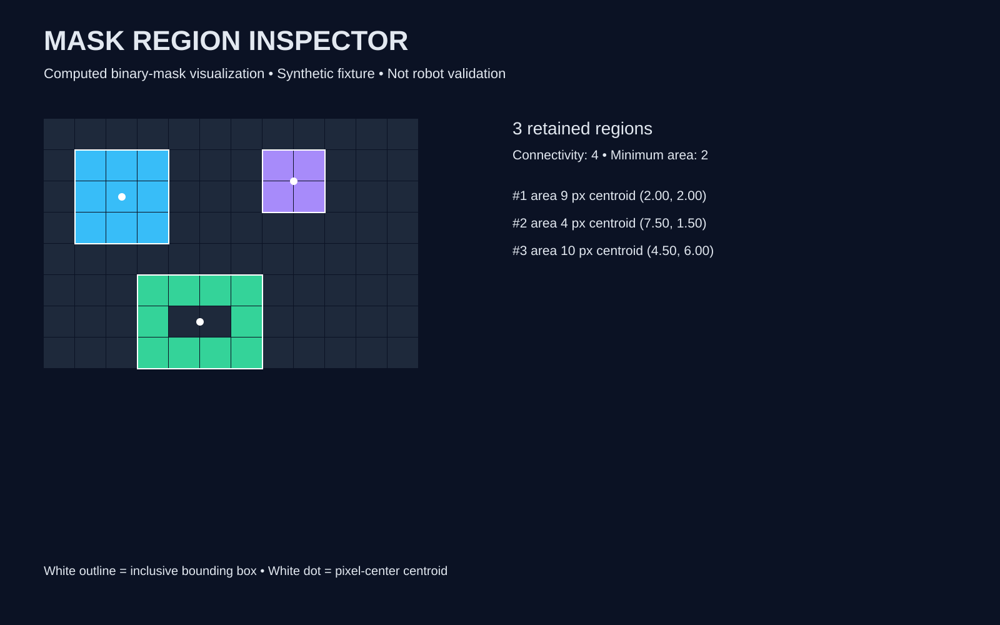

# Mask Region Inspector

An offline Python computer-vision learning tool for inspecting **connected regions in supplied binary masks**. Useful for understanding segmentation post-processing before studying robot perception. It does not generate segmentation predictions or recognize objects.



## What it does

- Validates rectangular JSON binary masks; limits input to 1 MB and 65,536 pixels.
- Compares four-neighbor and eight-neighbor connectivity.
- Filters small components and reports removed pixel count.
- Exports deterministic labels, area, inclusive bounding box, centroid, fill ratio and exposed four-edge perimeter.
- Produces a self-contained 1600 × 1000 SVG report with computed boxes and centroids. No network, telemetry or external packages.
- Refuses existing output directories to avoid overwriting reports.

## Run

Python 3.10+; standard library only. From this repository directory:

```sh
python regions.py sample.json --min-area 2 --out my-report
python regions.py sample.json --connectivity 8 --out comparison
python -B -m unittest -v
```

Open `my-report/regions.svg` in a browser; inspect `report.json` for all numerical regions and labels. Each new run needs a new output directory. Errors exit with status 2 and a readable explanation.

## Input and coordinates

```json
{"mask": [[0,1,1],[0,1,0]]}
```

Only integer 0 and 1 accepted, not booleans. `x` is the column, `y` the row; origin is top-left. Centroids average foreground pixel indices. Bounding boxes are `[xmin,ymin,xmax,ymax]`, inclusive. Fill ratio = area / bounding-box area. Perimeter counts exposed four-neighbor edges, even when connectivity is eight. Region IDs follow row-major first encounter and are reassigned after filtering. Zero labels include background and filtered components.

## Architecture

`regions.py`: validation → iterative flood-fill → measurements → JSON/SVG export and CLI.
`test_regions.py`: geometry, holes, diagonal connectivity, filtering, malformed input, size limit, CLI, overwrite protection and SVG parsing.
`sample.json`: original synthetic fixture; no downloaded datasets.
`regions.svg` and `report.json`: published reproducible demo outputs, not a screenshot or research benchmark. Generated locally into `demo/` and uploaded alongside the source for easy preview.

The demo uses min-area 2 and four-connectivity; expected retained areas are 9, 4 and 10 pixels, with one singleton removed.

## Limitations

This bounded demonstration assumes an already binary mask. No RGB image ingestion, learned model, semantic labels, tracking, calibrated dimensions or robot-control outputs. Components can merge touching objects; noise and connectivity choices change results. For large images use optimized image-processing tools. The graphic lists at most 12 regions; JSON contains all. Real-world robotics suitability has not been evaluated.

## Verification and provenance

Implementation and tests are AI-assisted portfolio work for Sadia Liaqat. Fixture and report are original synthetic examples under MIT. No claims of original research, production deployment or physical robot experiments.

Standard-library API references: [argparse](https://docs.python.org/3/library/argparse.html) and [json](https://docs.python.org/3/library/json.html).

See [VERIFICATION.md](VERIFICATION.md) for actual execution outcomes.
